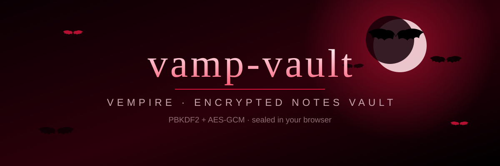

# vamp-vault

A client-side encrypted notes vault — seal notes with a passphrase using WebCrypto (PBKDF2 + AES-GCM), with encrypted JSON export/import.

## Features

- Encrypt and decrypt notes entirely in the browser; plaintext never leaves your device
- PBKDF2-SHA256 key derivation (100,000 iterations) feeding AES-GCM-256
- Random salt and IV per note, so identical notes produce different ciphertext
- Export the whole vault as encrypted JSON and import it on another device
- Sealed notes persist locally in `localStorage` (ciphertext only)
- Wrong passphrases and tampered ciphertext fail authentication cleanly

## Usage

Serve the folder with any static file server, then open it in a browser:

```sh
npx serve .
# or
python3 -m http.server 8000
```

Enter a passphrase, write a note, and choose **Encrypt & save**. Use **Decrypt** on a sealed note to read it again, **Export vault JSON** to download a backup, and **Import vault** to restore one.

The crypto logic is also importable as a module:

```js
import { encryptNote, decryptNote, serializeVault, deserializeVault } from "./app.js";

const payload = await encryptNote("meet me at midnight", "my passphrase");
const plain = await decryptNote(payload, "my passphrase"); // "meet me at midnight"

const backup = serializeVault([payload]);   // encrypted JSON string
const vault = deserializeVault(backup);     // { app, version, notes }
```

## Tests

```sh
node --test
```

Tests cover the encrypt/decrypt round-trip, wrong-passphrase and tamper failures, per-note randomness, and vault serialization. Requires Node 20 or newer (for WebCrypto).

## License

MIT © Lavish Gangwar. See [LICENSE](LICENSE).
